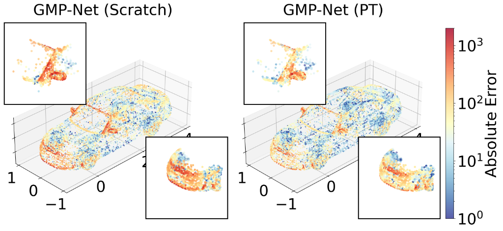
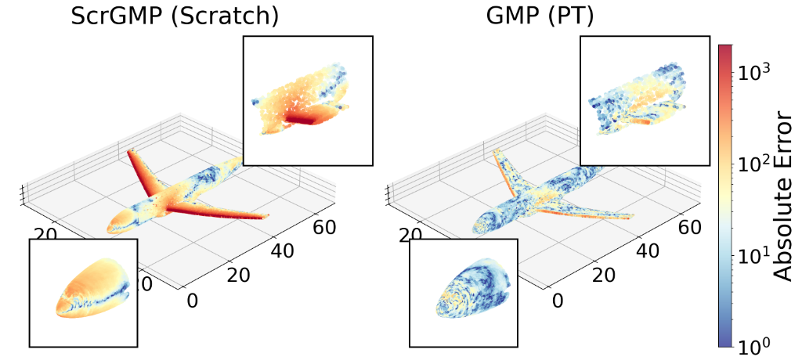

<h1 align="center">
  <br>Geometry Meets Physics (GMP)<br>
</h1>
<h4 align="center">Data-Efficient Pre-Training for Unstructured Neural PDE Solvers</h4>
<p align="center"><i>Accepted at NeurIPS 2026</i></p>

<p align="center">
<a href="https://arxiv.org/abs/2610.03363">
  
</a>
<a href="https://huggingface.co/thuerey-group">
  
</a>
<a href="LICENSE">
  
</a>
</p>

<p align="center">
  
  
</p>

## About

* **What is GMP?**

**GMP (Geometry Meets Physics)** is a disk-data-free pre-training framework for neural surrogate models on unstructured 3D geometries, tailored to both steady-state and transient physical regimes.

* **How is GMP different from existing PDE foundation models?**

GMP addresses the core bottlenecks of data generation, storage, and transferability in unstructured physical modeling:

1. **Pure Online Strategy (Disk-Data-Free):** Rather than relying on massive, expensive pre-computed simulation data stored on disk (which often consume terabytes of storage and suffer from severe I/O bottlenecks), GMP generates pre-training data purely on-the-fly. This eliminates disk-space requirements and makes large-scale pre-training lightweight and accessible.

2. **Dual-Regime Pre-Training:** Tailored to the distinct nature of steady-state and time-dependent physical problems:
   - **Steady-state regime (Geometry-driven):** GMP employs intrinsic shape descriptors (coordinates, curvatures, normals, and SGD) to learn rich representations of complex 3D domains without running expensive offline simulations.
   - **Transient regime (Physics-driven):** GMP uses GPU-accelerated solvers to generate synthetic PDE dynamics online, enabling scalable pre-training for time-dependent evolutions without storage overhead.

3. **Data-Efficient Downstream Transfer:** Models pre-trained with GMP achieve faster convergence, greater data efficiency, and higher accuracy during fine-tuning, delivering higher performance gains under realistic, low-data regimes.

4. **Architecture Versatility (Designed for GMP-Net, Proven on Baselines):** The pre-training framework is specifically designed for **GMP-Net** (our proposed architecture derived from [**SMART**](https://arxiv.org/abs/2601.18707) [Hagnberger & Niepert, ICML 2026], featuring a multi-branch geometry-physics formulation with cross-modal latent attention). Beyond GMP-Net, we also demonstrate that GMP pre-training generalizes effectively to other popular unstructured architectures, including **Transolver++** and **AB-UPT**.

5. **Phased Fine-Tuning & Warmup Adaptation:** Integrates structured fine-tuning schedules that freeze the pre-trained backbone while adapting task-specific projection heads and global context modulators, transitioning smoothly to full end-to-end training.

---

## Paper Info

<h4 align="center">Geometry Meets Physics: Data-Efficient Pre-Training for Unstructured Neural PDE Solvers</h4>
<h6 align="center">
  <a href="https://www.linkedin.com/in/luis-medrano-navarro-96a86721b/">Luis Medrano-Navarro</a>, 
  <a href="https://www.linkedin.com/in/giacomobaldan/">Giacomo Baldan</a>, 
  <a href="https://www.linkedin.com/in/qiang-liu-3a21b92b3/">Qiang Liu</a>, 
  <a href="https://www.linkedin.com/in/benjamin-holzschuh-022768236/">Benjamin Holzschuh</a>, 
  <a href="https://www.linkedin.com/in/jan-hagnberger/">Jan Hagnberger</a>, 
  <a href="https://mls-lab.org/">Mathias Niepert</a>, and 
  <a href="https://ge.in.tum.de/">Nils Thuerey</a>
</h6>

<h6 align="center">
    Technical University of Munich &amp; University of Stuttgart
</h6>

***Abstract:*** Neural surrogate models for Partial Differential Equations (PDEs) on unstructured 3D geometries are often limited by poor generalization and the high cost of generating large-scale training datasets. Consequently, pre-training on massive datasets of related PDE dynamics has emerged as a critical alternative to enhance the robustness and scalability of these models. However, this strategy is neither compute- nor data-efficient, as it relies on massive pre-computed data that is very costly to generate. In this work, we introduce a disk-data-free pre-training framework tailored to both steady-state and transient regimes. For steady-state problems, we propose a geometry-driven strategy that leverages intrinsic shape descriptors to learn representations of complex 3D domains. For transient problems, we introduce a physics-driven approach based on online generation of synthetic PDE data, enabling scalable pre-training without reliance on expensive datasets. Across multiple experiments, our approach achieves faster convergence, greater data efficiency, and higher accuracy during fine-tuning, particularly under realistic low-data regimes. This methodology provides a practical pathway toward data-efficient neural emulators for large-scale simulations.

***Read from:*** [[arXiv:2610.03363](https://arxiv.org/abs/2610.03363)]

***Cite as:***

```latex
@inproceedings{medrano2026geometry,
  title={Geometry Meets Physics: Data-Efficient Pre-Training for Unstructured Neural PDE Solvers},
  author={Medrano-Navarro, Luis and Baldan, Giacomo and Liu, Qiang and Holzschuh, Benjamin and Hagnberger, Jan and Niepert, Mathias and Thuerey, Nils},
  booktitle={The Fortieth Annual Conference on Neural Information Processing Systems},
  year={2026},
  url={https://openreview.net/forum?id=jidnQA2TIz}
}
```

---

## Supported Downstream Benchmarks

GMP is evaluated across six diverse downstream engineering benchmarks on unstructured surface and volumetric meshes, covering both steady-state and transient physical regimes:

### 1. Steady-State Benchmarks (Geometric Pre-Training Transfer)

| Benchmark | Physical Domain | Mesh Type | Target Output Fields | Description |
| :--- | :--- | :--- | :--- | :--- |
| **DrivAerML** | Automotive Aerodynamics | 3D Surface & Volume | Surface $p_s, \boldsymbol{\tau}$; Volume $p_v, \mathbf{u}$ | 500 geometric variations of the DrivAer notchback car model under fixed inlet velocity ($U_\infty = 30\,\text{m/s}$). Evaluates geometric generalization. |
| **SHIFT-Wing** | Aerospace Aerodynamics | 3D Surface & Volume | Surface $p_s, \boldsymbol{\tau}$; Volume $p_v, \mathbf{u}$ | Parametrically perturbed NASA Common Research Model (CRM) configurations under systematically varying operating conditions (Mach, Reynolds number, angle of attack). |
| **SHIFT-Crash** | Structural Mechanics | 3D Surface | Displacement $\mathbf{d}$, Von Mises Stress $\sigma_{\text{vM}}$ | Direct mapping from initial vehicle geometry and crash parameters to the final deformed state under steady-state formulation. |

### 2. Transient Autoregressive Benchmarks (Physics Pre-Training Transfer)

| Benchmark | Physical Domain | Mesh Type | Rollout Horizon | Description |
| :--- | :--- | :--- | :--- | :--- |
| **Kuramoto–Sivashinsky (KS)** | Chaotic Nonlinear Dynamics | 2D Deformed Grid | 30 steps | 2D chaotic spatiotemporal dynamics interpolated onto irregular grids. Tests cross-dimensional generalization (3D $\to$ 2D via zero-padding) and autoregressive stability. |
| **Flow Around Ellipse** | Fluid Mechanics (Unsteady CFD) | 2D Unstructured Mesh | 100 steps | Incompressible 2D flow past an elliptical obstacle, predicting evolving velocity and pressure fields. |
| **SHIFT-Crash** | Dynamic Impact Mechanics | 3D Surface | 12 steps | Autoregressive temporal rollout across 12 discrete time steps capturing high-rate nonlinear deformation dynamics and stress distribution during vehicle collision. |

---

## User Guide

### 1. Setup & Installation

Clone the repository and set up the Python 3.12 environment:

```bash
# Create and activate environment
conda create -n gmp python=3.12 -y
conda activate gmp

# Install dependencies
pip install -r requirements.txt
```

---

### 2. Pre-Trained Model Weights

Pre-trained model weights for GMP-Net and baselines are hosted on Hugging Face:
- 🔗 **[Hugging Face – Thuerey Group GMP Repository](https://huggingface.co/thuerey-group)**

Download the pre-trained checkpoints and place them in the corresponding `outputs_pretraining/` subfolders:

| Model / Regime | Pre-Training Stage | Destination Checkpoint Path |
| :--- | :--- | :--- |
| **GMP-Net** | Geometry Pre-Training (Steady) | `outputs_pretraining/gmpnet/epoch-200.pth` |
| **GMP-Net** | Physics Pre-Training (Transient) | `outputs_pretraining/gmpnet_physics/epoch-199-EMA.ckpt` |
| **AB-UPT** | Geometry Pre-Training | `outputs_pretraining/abupt/epoch-200.pth` |
| **Transolver++** | Geometry Pre-Training (Surface) | `outputs_pretraining/transolver_pp_surface/epoch-200.pth` |
| **Transolver++** | Geometry Pre-Training (Volume) | `outputs_pretraining/transolver_pp_volume/epoch-200.pth` |

Expected folder hierarchy:
```text
outputs_pretraining/
├── gmpnet/
│   └── epoch-200.pth
├── gmpnet_physics/
│   └── epoch-199-EMA.ckpt
├── abupt/
│   └── epoch-200.pth
├── transolver_pp_surface/
│   └── epoch-200.pth
└── transolver_pp_volume/
    └── epoch-200.pth
```

Once weights are placed in their respective folders, fine-tuning can be launched directly without any path changes.

---

### 3. Downstream Fine-Tuning & Training from Scratch

Downstream fine-tuning and evaluation runs are configured with Hydra. Execute training commands from the root repository directory:

```bash
# Steady-state fine-tuning (e.g., DrivAerML)
python -m src.train --config-name=config_gmpnet_drivaerml_pt

# Transient autoregressive fine-tuning (e.g., Kuramoto–Sivashinsky)
python -m src.train --config-name=config_gmpnet_ks_pt

# Training from scratch
python -m src.train --config-name=config_gmpnet_drivaerml_scratch
```

Configurations for all other benchmarks and baseline models (`config_abupt_*`, `config_transolverpp_*`) are located in `config/`.

---

### 4. Experiment Tracking (Weights & Biases)

Weights & Biases (`wandb`) is integrated for tracking experiments:
- **Default entity:** Set to `null`, meaning runs automatically log to your personal logged-in WandB account.
- **Custom entity / team:** Specify your entity at runtime:
  ```bash
  python -m src.train --config-name=config_gmpnet_drivaerml_pt wandb.entity=your_team_or_user
  ```
- **Disable WandB or run offline:**
  ```bash
  python -m src.train --config-name=config_gmpnet_drivaerml_pt wandb.setup.mode=disabled
  ```

---

## Directory Structure

```text
├── config/                        # Hydra configuration tree
│   ├── callbacks/                 # Callback configs (finetuning freeze schedule, metrics)
│   ├── data/                      # Dataset configs (drivaerml, crasht, ks)
│   ├── model/                     # Model architecture and checkpoint mapping configs
│   ├── trainer/                   # PyTorch Lightning trainer defaults
│   └── wandb/                     # Weights & Biases experiment tracking configs
├── outputs_pretraining/           # Pre-trained model checkpoints (download from Hugging Face)
├── src/
│   ├── callbacks/                 # FineTuneCallback, ModelStats, CarMetrics
│   ├── models/
│   │   ├── gmpnet/                # GMP-Net architecture and wrappers
│   │   ├── baselines/             # Transolver++, AB-UPT, and SMART baselines
│   │   └── fft/                   # Full fine-tuning (FFT) weight-loading wrappers
│   └── train.py                   # Downstream training entry point
└── requirements.txt
```

---

## Additional Info

This project is part of research in physics-based deep learning at the [**Physics-based Simulation group**](https://ge.in.tum.de/) at the Technical University of Munich (TUM).

---

## License

This project is licensed under the [Apache 2.0 License](LICENSE).
